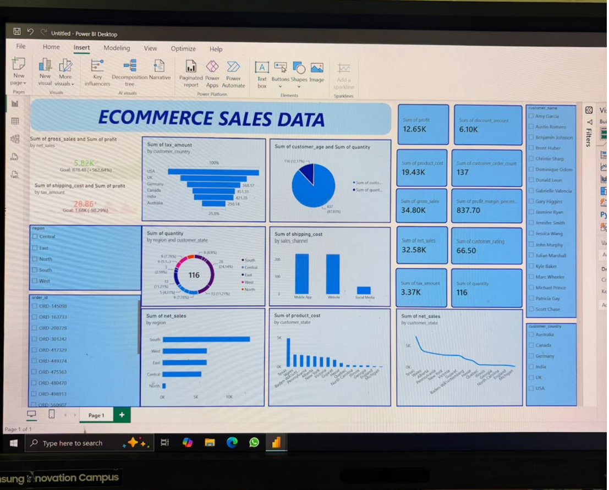
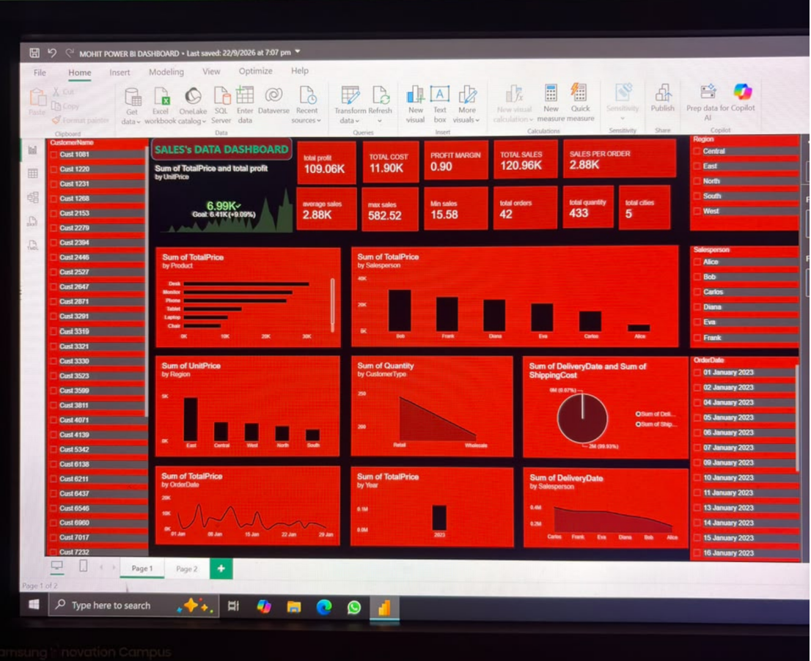
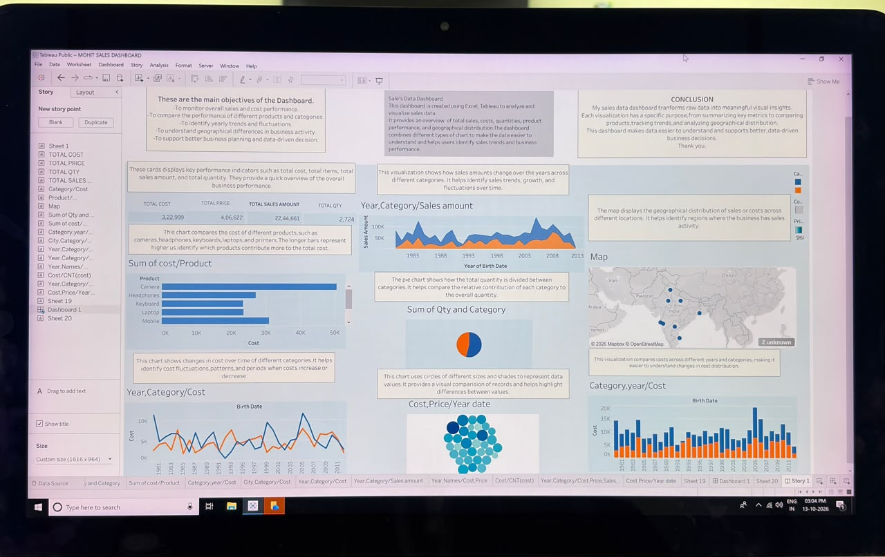

## Hi there, I'm [MOHIT SINGH] 👋

## 📊 Data Analyst & Business Intelligence Enthusiast

I turn complex, raw data into clear, actionable insights and interactive dashboards. Passionate about solving business problems through statistical modeling, SQL querying, and data visualization.

---

### 🛠️ Tech Stack & Tools
* **Languages & Querying:** Python (Pandas, NumPy, Scikit-Learn), SQL (PostgreSQL, MySQL, BigQuery), R
* **Data Visualization:** Tableau, Power BI, Looker Studio, Matplotlib, Seaborn
* **Databases & Cloud:** Snowflake, AWS (S3), Google Cloud Platform, Microsoft Excel (Advanced, VBA)
* **Tools & Workflow:** Git, Jupyter Notebooks, Docker, Airflow

---

### 🚀 Featured Projects

| Project Name | Description | Tech Stack | Image|
| :--- | :--- | :--- | :--- |
| **[E-Commerce Sale's Data Dashboard]()** | This project helped me strenghten my skills in data cleaning, exploratory data analysis, KPI development, and dashboard design. It also improved my ability to convert complex datasets into clear, actionable visual insights. | Excel, Pyhton, Power BI ||
| **[Sale's Data Dashboard Data Analysis]()** | Excited to share my Sale's Data Dashboard created using Microsoft Power BI!The goal of this project was to transform raw sales data into meaningful insights through interactive visualizations and KPI cards, helping identify sales trends and understand business performance. | Excel, PostgreSQL, Power BI|  
| **[Sale's Data Analysis]()** | This project focuses on transforming raw sales data into meaningful visuals insights through interactive charts, graphs, geographical maps and key performance indicators (KPIs).| Excel, Python |          

---

### 📫 Let's Connect
* **LinkedIn:** [Connect with me on LinkedIn](https://www.linkedin.com/in/mohit-singh-459a9b343?utm_source=share_via&utm_content=profile&utm_medium=member_ios)
* **Email:** mohitsingh60470"gmail.com
* **Portfolio Website:** [yourportfolio.com]()